  

  
  
  
  

## 👋 Hi, I'm Sandeep

**Qt/QML & C++ software developer · Game developer & technical artist** — ~10 years in software and ~10 years in game development. **Open to work in Finland.**

- 🧩 **Qt/QML** is my strongest skill — C++ middleware and **embedded Linux HMI**
- 🔧 Designed and delivered **6 MCU applications** from design to finish
- 🏥 Built a **medical scanning application** with Qt
- 🎨 End-to-end product work: **concept → Figma → Qt → backend**
- 🎮 Game / technical artist: shaders, Blender, ZBrush, 2D/3D art — **5 games** shipped
- 📱 Android & web interactive apps, VR/AR

<b>📖 About me</b>

 

**Software (~10 years)**
- Almost 5 years at **The Qt Company**
- 3 years at **Siili Solutions**
- 2 years at CyberLightning IT Company
- Qt/QML, C++ middleware, embedded Linux HMI, 6 MCU applications from design to finish
- Medical scanning application built with Qt
- End-to-end: concept → Figma → Qt → backend

**Game development (~10 years)**
- Fingersoft, Empires Games, Namida Games, Veikkaus
- 5 games; game artist & technical artist
- Blockchain game **Paradise Tycoon**
- Shaders, Blender, ZBrush, 2D/3D art

**Interactive apps**
- Android & web interactive apps, including a 2026 global-warming interactive Android app for the **City of Oulu**
- VR/AR

**Languages:** Finnish (YKI certificate)

## 🛠 Tech stack

  

## 🚆 Featured project

<table>
<tr>
<td width="55%">

</td>
<td>

### [Junaliikenne Live – Rail Traffic Monitor](https://github.com/sandeepariyar/Junaliikenne-Live---Rail-Traffic-Monitor)
Accessible rail operations dashboard with **Lit Web Components**, real **Digitraffic** data and a **Three.js** low-poly 3D map.

</td>
</tr>
</table>

<a href="https://www.behance.net/sandeePPariyar">Behance</a> · Oulu, Finland 🇫🇮

