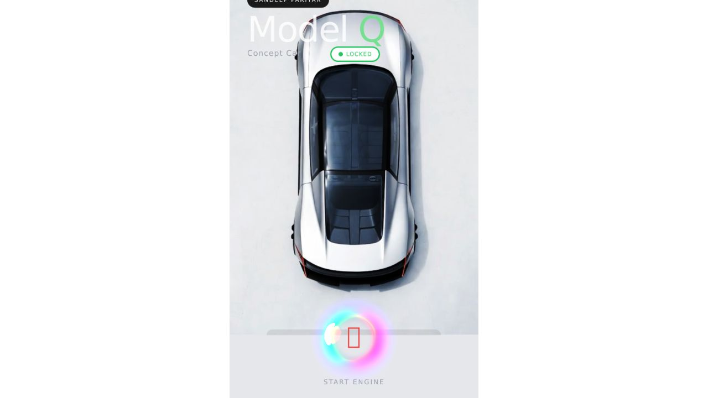

# Sandeep Pariyar

**Design Engineer · Embedded HMI · Interactive Frontend**

I design interfaces and build the software behind them. My work spans Qt/QML and C++ for embedded touchscreens, accessible web components, and real-time 3D.

**Oulu, Finland** · Open to roles in Finland and available to relocate to Helsinki

[Email me](mailto:sandeep.pariyar@gmail.com) · [Call +358 40 197 7348](tel:+358401977348) · [Behance portfolio](https://www.behance.net/sandeePPariyar)

- **Embedded and application delivery:** Six MCU applications from design through implementation, plus a Qt medical scanning application.
- **Professional experience:** Around ten years in software, including The Qt Company, Siili Solutions, and CyberLightning.
- **Visual and technical art:** Five shipped games, with work across shaders, 2D and 3D assets, and interactive graphics.

## Featured projects

These browser demos show how I translate interface design into working software. Start with either side-by-side comparison.

<table>
<tr>
<td width="50%" valign="top">
<h3>Revontuli · EV rear-seat HMI</h3>

Five interactive cabin screens, from climate and seat controls to lighting and media. Compare the original design with LVGL rendering and a C++ state model.

<strong>LVGL · C++ · WebAssembly</strong>

<a href="https://sandeepariyar.github.io/revontuli-embedded-ui-demo/compare/"><strong>▶ Try the live demo</strong></a> · <a href="https://github.com/sandeepariyar/revontuli-embedded-ui-demo">Engineering notes &amp; source</a>

</td>
<td width="50%" valign="top">
<h3>NORDVENT · Smart-building HMI</h3>

Compare a native Qt Quick interface with its web design reference. Explore room controls, airflow, and blinds, then inspect live C++ state.

<strong>Qt Quick · QML · C++17 · WebAssembly</strong>

<a href="https://sandeepariyar.github.io/NORDVENT-Cross-Platform-Smart-Building-HMI-Web-Native-Qt-C-/#live"><strong>▶ Try the live demo</strong></a> · <a href="https://github.com/sandeepariyar/NORDVENT-Cross-Platform-Smart-Building-HMI-Web-Native-Qt-C-">Engineering notes &amp; source</a>

</td>
</tr>
</table>

Both demos use simulated equipment. Their memory budgets document the path to embedded deployment.

## More selected work

<table>
<tr>
<td colspan="2" valign="top">

<h3>Junaliikenne · Rail traffic operator dashboard</h3>

Lit Web Components used from React via @lit/react and from plain HTML, explicit live/stale/offline data states from Digitraffic, and axe-core accessibility tests in CI.

<strong>Lit · React · TypeScript · Three.js · Playwright</strong>

<a href="https://sandeepariyar.github.io/Junaliikenne-Live---Rail-Traffic-Monitor/">Try live demo ↗</a> · <a href="https://github.com/sandeepariyar/Junaliikenne-Live---Rail-Traffic-Monitor#design-engineering-case-study">Case study</a> · <a href="https://github.com/sandeepariyar/Junaliikenne-Live---Rail-Traffic-Monitor">View source</a>

</td>
</tr>
<tr>
<td width="50%" valign="top">

<h3>HELIOS · Energy management cockpit</h3>

Interactive energy simulation, battery views and optimized UI assets.

<strong>Qt Quick · C++ · Figma</strong>

<a href="https://sandeepariyar.github.io/HELIOS-MCU/">Try live demo ↗</a> · <a href="https://github.com/sandeepariyar/HELIOS-MCU">View source</a>

</td>
<td width="50%" valign="top">

<h3>AutoAura · Automotive HMI</h3>

Animated vehicle interface with charging, climate and door controls.

<strong>Qt 6 · QML · C++ · WebAssembly</strong>

<a href="https://sandeepariyar.github.io/AutoAura/">Try live demo ↗</a> · <a href="https://github.com/sandeepariyar/AutoAura">View source</a>

</td>
</tr>
<tr>
<td width="50%" valign="top">

<h3>RONIUM · Earth observation</h3>

Rotatable globe, scroll choreography and a public-imagery mission console.

<strong>React · Three.js · WebGL</strong>

<a href="https://sandeepariyar.github.io/ronium-earth-observation/">Try live demo ↗</a> · <a href="https://github.com/sandeepariyar/ronium-earth-observation">View source</a>

</td>
<td width="50%" valign="top">

<h3>ProHealth · 3D anatomy explorer</h3>

Spatial inspection, anatomy layers and an educational visualization workflow.

<strong>React · TypeScript · Three.js</strong>

<a href="https://sandeepariyar.github.io/ProHealth-Interactive-3D-Human-Anatomy-Healthcare-Learning-Platform/">Try live demo ↗</a> · <a href="https://github.com/sandeepariyar/ProHealth-Interactive-3D-Human-Anatomy-Healthcare-Learning-Platform">View source</a>

</td>
</tr>
</table>

## Skills and background

| Focus | Tools and experience |
| --- | --- |
| Embedded HMI | Qt Quick, QML, C++, LVGL, embedded Linux, CMake |
| Frontend and design systems | React, TypeScript, Lit, accessible components, Figma |
| Real-time graphics | Three.js, WebGL, shaders, Unity, Blender, ZBrush |
| Android | Kotlin, Jetpack Compose |

<strong>Additional experience</strong>

- Technical art and game development with Fingersoft, Empires Games, Namida Games, and Veikkaus. Projects include Paradise Tycoon.
- Interactive Android and web projects, including a 2026 climate education app for the City of Oulu.
- Founder of Ronixtieto, a nonprofit.
- Finnish language proficiency certified through YKI.

[Get in touch](mailto:sandeep.pariyar@gmail.com) · [Browse all repositories](https://github.com/sandeepariyar?tab=repositories)
