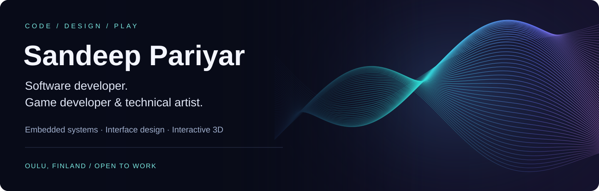
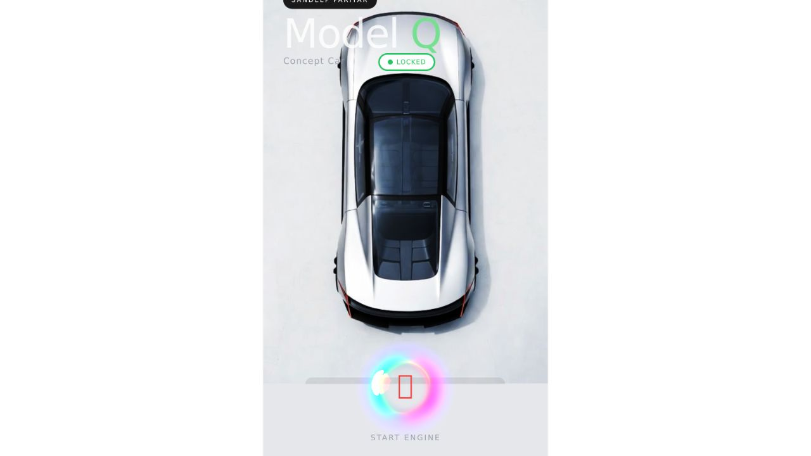
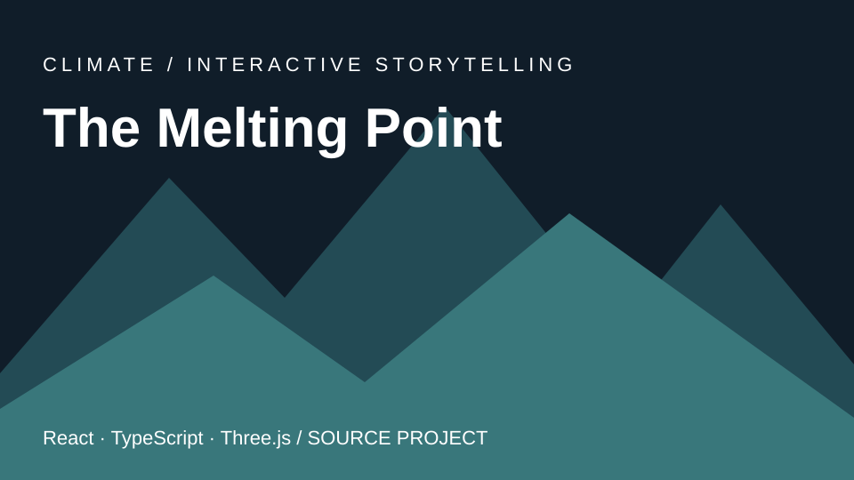

# Sandeep Pariyar
**Software developer · Game developer & technical artist · Interface design**

Oulu, Finland · **Open to work in Finland** · Founder of **Ronixtieto**, a nonprofit

[Email](mailto:sandeep.pariyar@gmail.com) · [+358 40 197 7348](tel:+358401977348) · [Design portfolio on Behance](https://www.behance.net/sandeePPariyar)

I turn interface concepts into working software—from Figma and visual design to Qt/QML, C++ and interactive graphics. My background combines software engineering with game development and technical art.

- **Software:** around 10 years, including The Qt Company, Siili Solutions and CyberLightning.
- **Delivery:** six MCU applications from design to finish, plus a Qt medical scanning application.
- **Visual craft:** five shipped games, shader work, 2D/3D art and spatial interaction.

## 🛠 Tech stack

  

## Selected work

**Explore software engineering, interactive graphics and interface design through working projects.** Click a preview to explore. Browser demos require no installation; Qt WebAssembly demos may take a moment to load.

<table>
<tr>
<td width="50%" valign="top">

<h3>AutoAura · Automotive HMI</h3>

Animated vehicle interface with charging, climate and door controls.

<strong>Qt 6 · QML · C++ · WebAssembly</strong>

<a href="https://sandeepariyar.github.io/AutoAura/">Try live demo ↗</a> · <a href="https://github.com/sandeepariyar/AutoAura">View source</a>

</td>
<td width="50%" valign="top">

<h3>HELIOS · Energy management cockpit</h3>

Interactive energy simulation, battery views and optimized UI assets.

<strong>Qt Quick · C++ · Figma</strong>

<a href="https://sandeepariyar.github.io/HELIOS-MCU/">Try live demo ↗</a> · <a href="https://github.com/sandeepariyar/HELIOS-MCU">View source</a>

</td>
</tr>
<tr>
<td width="50%" valign="top">

<h3>RONIUM · Earth observation</h3>

Rotatable globe, scroll choreography and a public-imagery mission console.

<strong>React · Three.js · WebGL</strong>

<a href="https://sandeepariyar.github.io/ronium-earth-observation/">Try live demo ↗</a> · <a href="https://github.com/sandeepariyar/ronium-earth-observation">View source</a>

</td>
<td width="50%" valign="top">

<h3>ProHealth · 3D anatomy explorer</h3>

Spatial inspection, anatomy layers and an educational visualization workflow.

<strong>React · TypeScript · Three.js</strong>

<a href="https://sandeepariyar.github.io/ProHealth-Interactive-3D-Human-Anatomy-Healthcare-Learning-Platform/">Try live demo ↗</a> · <a href="https://github.com/sandeepariyar/ProHealth-Interactive-3D-Human-Anatomy-Healthcare-Learning-Platform">View source</a>

</td>
</tr>
<tr>
<td width="50%" valign="top">

<h3>Junaliikenne · Rail traffic monitor</h3>

Rail dashboard with demo scenarios, Digitraffic live mode and accessibility features.

<strong>React · Lit · TypeScript · Three.js</strong>

<a href="https://sandeepariyar.github.io/Junaliikenne-Live---Rail-Traffic-Monitor/">Try live demo ↗</a> · <a href="https://github.com/sandeepariyar/Junaliikenne-Live---Rail-Traffic-Monitor">View source</a>

</td>
<td width="50%" valign="top">

<h3>The Melting Point · Climate kiosk</h3>

Multilingual climate storytelling with 3D terrain and data visualizations.

<strong>React · TypeScript · Three.js</strong>

<a href="https://github.com/sandeepariyar/The-Melting-Point">View source</a> · Source project

</td>
</tr>
</table>

Previews use application screenshots or existing project imagery. The Melting Point uses a title card. ProHealth, HELIOS and RONIUM are portfolio prototypes with illustrative or simulated states—see each repository for scope and limitations.

## How I work

**Concept → Figma → implementation → interaction polish.** I connect visual design with application behavior, with particular interest in embedded interfaces, graphics performance and clear human-machine interaction.

| Focus | Tools and experience |
| --- | --- |
| HMI & application engineering | Qt, QML, C++, embedded Linux, CMake |
| Interactive web & graphics | React, TypeScript, Three.js, WebGL, shaders |
| Design & technical art | Figma, Blender, ZBrush, Unity, 2D/3D art |
| Mobile | Kotlin, Jetpack Compose, Android |

<b>Experience and background</b>

 

**Software (~10 years)**
- Almost 5 years at **The Qt Company**
- 3 years at **Siili Solutions**
- 2 years at CyberLightning IT Company
- Qt/QML, C++ middleware, embedded Linux HMI, 6 MCU applications from design to finish
- Medical scanning application built with Qt
- End-to-end: concept → Figma → Qt → backend

**Game development (~10 years)**
- Fingersoft, Empires Games, Namida Games, Veikkaus
- 5 games; game artist & technical artist
- Blockchain game **Paradise Tycoon**
- Shaders, Blender, ZBrush, 2D/3D art

**Interactive apps**
- [AutoAura](https://sandeepariyar.github.io/AutoAura/) — interactive automotive dashboard built with Qt, C++ and QML, compiled to WebAssembly for the browser
- Android & web interactive apps, including a 2026 global-warming interactive Android app for the **City of Oulu**
- VR/AR

**Languages:** Finnish (YKI certificate)

## Opportunities

Interested in **software development, embedded HMI, game development, interface design and technical art roles in Finland**. Based in Oulu; Finnish YKI certificate.

**Contact:** [sandeep.pariyar@gmail.com](mailto:sandeep.pariyar@gmail.com) · [+358 40 197 7348](tel:+358401977348)

[Explore my design portfolio](https://www.behance.net/sandeePPariyar) · [Browse all repositories](https://github.com/sandeepariyar?tab=repositories)
